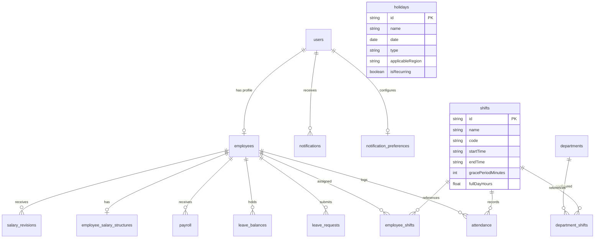

\# Techflow Enterprise HRMS (Human Resource Management System)

A secure, scalable, full-stack Human Resource Management System (HRMS) built to simulate real-world enterprise workforce management, payroll flexibility, shift scheduling, centralized calendar operations, and employee engagement features through granular role-based access control (Admin, HR, Employee).

---

## 🌟 Executive Summary & Enterprise Deliverables

| Deliverable | Location in Repository | Description |
| :--- | :--- | :--- |
| **Backend Source Code** | [`backend/`](file:///c:/Users/manda/OneDrive/Desktop/ai%20saas%20backend%20training/Human%20Resource%20Management%20System%20%28HRMS/backend), [`routes/`](file:///c:/Users/manda/OneDrive/Desktop/ai%20saas%20backend%20training/Human%20Resource%20Management%20System%20%28HRMS/routes), [`services/`](file:///c:/Users/manda/OneDrive/Desktop/ai%20saas%20backend%20training/Human%20Resource%20Management%20System%20%28HRMS/services), [`models/`](file:///c:/Users/manda/OneDrive/Desktop/ai%20saas%20backend%20training/Human%20Resource%20Management%20System%20%28HRMS/models) | Python, FastAPI, SQLAlchemy ORM, MySQL (`hrms_db`), ReportLab, PyJWT, bcrypt |
| **Frontend Source Code** | [`frontend/`](file:///c:/Users/manda/OneDrive/Desktop/ai%20saas%20backend%20training/Human%20Resource%20Management%20System%20%28HRMS/frontend) | React 19, Vite, bespoke Vanilla CSS Design System, Lucide icons |
| **Database Schema (DDL)** | [`database/schema.sql`](file:///c:/Users/manda/OneDrive/Desktop/ai%20saas%20backend%20training/Human%20Resource%20Management%20System%20%28HRMS/database/schema.sql) | Clean MySQL InnoDB DDL statements with foreign keys & indexes |
| **Database Dump (Data + DDL)** | [`database/hrms_dump.sql`](file:///c:/Users/manda/OneDrive/Desktop/ai%20saas%20backend%20training/Human%20Resource%20Management%20System%20%28HRMS/database/hrms_dump.sql) | Full MySQL SQL dump with all 14 tables, relations, and pre-seeded enterprise sample data |
| **Postman API Collection** | [`postman/HRMS_API_Collection.postman_collection.json`](file:///c:/Users/manda/OneDrive/Desktop/ai%20saas%20backend%20training/Human%20Resource%20Management%20System%20%28HRMS/postman/HRMS_API_Collection.postman_collection.json) | 48 API requests across 11 modules with automated JWT token handling |
| **Automated Verification Script** | [`verify_all_features.ps1`](file:///c:/Users/manda/OneDrive/Desktop/ai%20saas%20backend%20training/Human%20Resource%20Management%20System%20%28HRMS/verify_all_features.ps1) | 11-module automated PowerShell test suite verifying 100% of Phase 1 & 2 features |

---

## 🔑 Sample Test Credentials

All accounts come pre-configured with active profiles, assigned shifts, detailed salary structures, and historical logs:

| Role | Email Address | Password | Name & Department | Permissions & Scope |
| :--- | :--- | :--- | :--- | :--- |
| **ADMIN** | `admin@hrms.com` | `Admin@123` | **Mandala Lokesh** (Executive) | Full system governance, holiday creation, shift assignments, salary revisions, broadcast announcements, payroll locking, overrides |
| **HR** | `hr@hrms.com` | `Hr@123` | **Giri Prasad** (HR) | Employee onboarding, leave approvals, attendance tracking, shift scheduling, monthly payroll review |
| **EMPLOYEE** | `employee@hrms.com` | `Employee@123` | **Kiran V** (Engineering) | Lead Software Engineer - Attendance punch, assigned shift view, leave requests, payslip PDF download |
| **EMPLOYEE** | `naveen.g@hrms.com` | `Welcome@123` | **Naveen G** (Engineering) | Senior Frontend Architect |
| **EMPLOYEE** | `ramya.p@hrms.com` | `Welcome@123` | **Ramya P** (Product & Design) | Staff Product Designer |
| **EMPLOYEE** | `guna.sekhar@hrms.com` | `Welcome@123` | **Guna Sekhar V** (Finance) | Senior Financial Analyst |
| **EMPLOYEE** | `keerthi.m@hrms.com` | `Welcome@123` | **Keerthi M** (Marketing) | Growth Marketing Lead |
| **EMPLOYEE** | `eeswar.m@hrms.com` | `Welcome@123` | **Eeswar M** (DevOps) | DevOps & Cloud Engineer |

---

## 🚀 Quick Start Guide

### Prerequisites
- **Python**: 3.10+ (tested on Python 3.14)
- **MySQL Server**: Running on port 3306 (database: `hrms_db`)
- **Node.js**: v18+ (tested on Node v24)
- **npm**: v9+ (tested on npm v11)

### 1. Backend Setup (FastAPI + MySQL)
```bash
# 1. Install dependencies
pip install -r requirements.txt

# 2. Seed MySQL database (Seeds 18 holidays, 5 shifts, salary structures, attendance, notifications)
python backend/seed.py

# 3. Start FastAPI server with Uvicorn
python -m uvicorn main:app --reload --port 5000
# Or simply: python main.py
```
*Backend server runs on `http://localhost:5000` (Health Check: `http://localhost:5000/api/health`, Swagger Docs: `http://localhost:5000/docs`)*

### 2. Frontend Setup
```bash
cd frontend
npm install
npm run dev
```
*Frontend application launches on `http://localhost:5173` (or `http://localhost:5174`)*

### 3. Run Automated E2E Test Suite
The repository includes an automated end-to-end integration test runner in PowerShell:
```powershell
powershell -ExecutionPolicy Bypass -File .\verify_all_features.ps1
```
Expected output:
```
==============================================================
 EXECUTING COMPLETE ENTERPRISE HRMS VERIFICATION (PHASE 1 & 2)
==============================================================

Checking if FastAPI Backend Server is running on port 5000...
  Backend Server is ONLINE! Service: HRMS Enterprise Backend
  Database Status: MySQL (hrms_db)

[1/11] Testing Authentication and Token Generation for RBAC Roles...
  Admin Login: SUCCESS - Role: ADMIN
  HR Login: SUCCESS - Role: HR
  Employee Login: SUCCESS - User: Kiran V (ID: 4da47770-95e0-4286-9ca5-721764360856)

[2/11] Testing Protected Profile and Employee Directory...
  Profile Verified: admin@hrms.com (ADMIN)
  Retrieved 8 employee profiles from enterprise directory

[3/11] Testing Attendance Punch with Shift Timings & Admin Override...
  Duplicate or existing check-in correctly guarded: Handled
  Admin Attendance Override: SUCCESS (isOverride = True, hours = 8.5)

[4/11] Testing Leave Application and Approval Workflow...
  Leave Quota Balances: Available (Testing with CL)
  Leave Applied: ID 803910c4-7b85-413e-af4c-98b0d61a44f7 Status: PENDING
  Leave Review: Status updated to APPROVED by HR

[5/11] Testing Holiday & Calendar Management Module...
  Retrieved 18 holidays for Year 2026
  Retrieved 4 upcoming holidays from current date
  October 2026 Calendar Summary: Total=31, Weekends=9, Holidays=2, Standard Working Days=20
  Admin Created New Holiday: ID a8630c74-73fa-4828-853a-f845384e457e - Test Enterprise Innovation Day
  Cleaned up test holiday: Holiday 'Test Enterprise Innovation Day' deleted successfully

[6/11] Testing In-App Notification Center & Broadcast Announcements...
  Retrieved 9 in-app notifications (Unread: 9)
  Employee Notification Preferences: Email=True, Leaves=True, Payroll=True, Announcements=True
  Updated Notification Preferences: SUCCESS
  Admin Broadcast Announcement Dispatched: Recipients Count = 8

[7/11] Testing Shift & Work Schedule Management...
  Retrieved 5 enterprise shift configurations
  Current Employee Assigned Shift: Flexible Shift (10:00 - 19:00)
  Assigned Shift to Department: SUCCESS (ENGINEERING -> Shift ID 6ecdfe1b-2517-4002-82eb-69277d036abe)
  Employee Shift History Timeline: 1 entries recorded
  Shift Attendance Report: Total Logs = 5

[8/11] Testing Advanced Payroll & Compensation Structure...
  Employee Compensation: Base=65000.0, HRA=26000.0, OvertimeRate=375.0
  Salary Revision Processed: Revision ID 1379a3e4-d463-436c-a904-3985bd5ea27b - New Gross: 126500.0, Increment: +4.98%
  Compensation History: 2 revision audit records on file
  Dynamic Payroll Generated: Calculated for 8 staff members (Holiday-aware working days & overtime)
  Official ReportLab Payslip PDF Downloaded: downloaded_test_slip.pdf (4053 bytes)

[9/11] Testing Reports and Analytics CSV & PDF Exports...
  Dashboard Stats: Total Staff 8, Present 1
  Payroll Summary CSV Exported: payroll_report.csv (711 bytes)
  Analytics PDF Report Exported: analytics_report.pdf (2600 bytes)

[10/11] Testing Audit Trail & Email Dispatch Logs...
  System Audit Trail: 30 entries recorded in database
  Dispatched Email Logs: 7 notifications logged

[11/11] Verifying Enterprise Deliverable Files on Disk...
  [OK] Found schema.sql (16469 bytes)
  [OK] Found hrms_dump.sql (104188 bytes)
  [OK] Found HRMS_API_Collection.postman_collection.json (26820 bytes)
  [OK] Found requirements.txt (217 bytes)
  [OK] Found README.md (18420 bytes)

==============================================================
 ALL HRMS PHASE 1 & 2 FEATURES VERIFIED WITH 100% SUCCESS!
==============================================================
```

---

## 🏛️ System Architecture & Phase 2 Modules

### 1. Holiday & Calendar Management (Phase 2)
- **Centralized Holiday Repository**: Classifies company holidays into:
  - `COMPANY`: Universal paid holidays observed company-wide.
  - `REGIONAL`: Applicable to specific branch locations/regions.
  - `OPTIONAL` (Restricted): Floater holidays employees can choose to avail.
- **Calendar Visualization**:
  - Interactive **Monthly Grid Calendar** showing all days of the month, weekends highlighted, and holidays with colored classification tags.
  - **Yearly Schedule Table** with quick filters by Year and Type.
- **Dynamic Workday Summary Engine**:
  - Formula: `standardWorkingDays = totalDaysInMonth - weekendDays - weekdayHolidays`
  - Prevents double-deductions when holidays fall on weekends.
  - Automatically excludes recognized company holidays from absence / Loss of Pay calculations.
- **Admin Management**: Full CRUD modal for Admins/HR to define, update, or remove company holidays with region and description tracking.

### 2. In-App Notification Center & Broadcast Announcements (Phase 2)
- **Real-Time Header Dropdown**:
  - Notification bell with unread indicator badge and numeric counter.
  - Dropdown feed displaying notifications with status badges (`LEAVE`, `PAYROLL`, `ATTENDANCE`, `ANNOUNCEMENT`).
  - Read/unread tracking with instant single-click "Mark Read" and "Mark All Read".
- **User Preference Management**:
  - Granular modal where each employee can toggle notifications for:
    - `Email Alerts`
    - `Leave Status Changes`
    - `Payroll Processing Alerts`
    - `Attendance & Late Alerts`
    - `Admin Broadcast Announcements`
- **Admin Broadcast Center**:
  - Admin users can compose and dispatch announcements to:
    - Selected Departments (e.g. `ENGINEERING`, `FINANCE`, `SALES`)
    - Entire Organization (`ORGANIZATION`)
  - Generates notifications for all matching active employees and dispatches priority notifications.

### 3. Shift & Work Schedule Management (Phase 2)
- **Predefined Work Shifts**:
  - `General Shift (GEN)`: 09:00 - 18:00 (15 min grace, 15 min early exit threshold)
  - `Morning Shift (MORN)`: 06:00 - 15:00
  - `Night Shift (NIGHT)`: 21:00 - 06:00 (overnight shift support)
  - `Flexible Shift (FLEX)`: 10:00 - 19:00
  - `Remote Shift (REMOTE)`: 09:00 - 18:00
- **Flexible Assignment Hierarchy**:
  - **Employee Assignment** (Highest Priority) > **Department Assignment** > **System Default (GEN)**.
- **Punctuality & Shift Timing Logic**:
  - `Late Check-In`: Check-in time evaluated against shift start time + grace period (e.g., check-in after 09:15 triggers `isLate=True` and calculates `lateMinutes`).
  - `Early Check-Out`: Check-out time evaluated against shift end time - threshold (triggers `isEarlyExit=True` and calculates `earlyExitMinutes`).
  - `Overtime Calculation`: Working hours exceeding shift duration (e.g. 8 hours) automatically compute `overtimeHours`.
- **Shift History & Reporting**:
  - Immutable historical timeline of all past shift assignments per employee.
  - Shift-wise attendance report displaying employee roster, shift timings, punch logs, late minutes, early exits, and overtime hours.
  - Admin shift override modal allowing operations managers to waive late flags or adjust overtime with mandatory audit reasons.

### 4. Advanced Payroll & Compensation Structure (Phase 2)
- **Itemized Salary Structures**:
  - **Earnings**: Basic Pay (50%), House Rent Allowance (HRA - 20%), Conveyance Allowance, Medical Allowance, Special Allowance, Overtime Hourly Rate.
  - **Deductions**: Provident Fund (PF - 12% of Basic), Tax Deducted at Source (TDS), Professional Tax (PT), Loss of Pay (LOP) Deduction, Other Deductions.
- **Dynamic Attendance & Holiday Adjustment Engine**:
  - Working days dynamically determined based on monthly calendar and company holidays.
  - `Daily Rate = Base Salary / Standard Working Days`
  - `LOP Deduction = Daily Rate * LOP Days`
  - `Overtime Pay = Overtime Hours * Overtime Hourly Rate`
  - `Gross Salary = Base + HRA + Allowances + Overtime Pay + Bonus + Variable Pay`
  - `Net Salary = Gross Salary - Total Deductions`
- **Salary Revision Workflow**:
  - Formal compensation revision submission capturing previous gross, new gross, component breakdown, increment percentage, effective date, and business reason (e.g., `Annual Appraisal`, `Promotion`, `Market Adjustment`).
  - Automatically updates active salary structure and employee profile.
  - Complete revision audit history preserved with author tracking.
- **Enhanced ReportLab PDF Salary Slips**:
  - Corporate executive styling with attendance metrics header (Standard Working Days, Holidays, Present Days, Overtime Hours).
  - Side-by-side Earnings & Deductions breakdown table.
  - Transaction reference, bank account details, and authorized digital signatory.

---

## 🗄️ Database Schema & Entities

The relational database architecture is built in MySQL InnoDB with referential integrity and cascading relationships:



---

## 📡 REST API Reference

### 1. Authentication & Profile
- `POST /api/auth/login` - Authenticate user & issue JWT bearer token
- `GET /api/auth/me` - Get authenticated user profile & permissions
- `POST /api/auth/change-password` - Update account password

### 2. Employees Directory
- `GET /api/employees` - List employees with department & status filter
- `POST /api/employees` - Onboard new employee (auto-initializes leave balances & default salary structure)
- `GET /api/employees/{id}` - Get full employee dossier
- `PUT /api/employees/{id}` - Update employee demographic and job details
- `PATCH /api/employees/{id}/status` - Activate or deactivate employee account

### 3. Attendance & Shift Regularization
- `POST /api/attendance/check-in` - Record check-in punch (evaluates shift timings & late arrival)
- `POST /api/attendance/check-out` - Record check-out punch (computes working hours & overtime)
- `GET /api/attendance/today` - Today's punch status and active shift details
- `GET /api/attendance/my` - Employee monthly attendance register
- `GET /api/attendance/all` - Organization-wide attendance register
- `POST /api/attendance/override` - Admin/HR punch override with mandatory audit reason

### 4. Leave Management
- `GET /api/leaves/balances` - Available leave balances (CL, SL, PL, LOP)
- `POST /api/leaves/apply` - Submit leave application
- `GET /api/leaves/my` - Employee leave request history
- `GET /api/leaves/all` - HR/Admin leave review queue
- `PATCH /api/leaves/{id}/review` - Approve or reject leave application

### 5. Holiday & Calendar Management (Phase 2)
- `GET /api/holidays` - List all holidays (filter by year and type)
- `GET /api/holidays/upcoming` - Upcoming holidays feed (next 30-90 days)
- `GET /api/holidays/calendar-summary` - Working days, weekends, and holidays breakdown
- `POST /api/holidays` - Create company holiday (Admin/HR)
- `PUT /api/holidays/{id}` - Update holiday details
- `DELETE /api/holidays/{id}` - Remove holiday entry

### 6. In-App Notification Center & Broadcasts (Phase 2)
- `GET /api/notifications` - Get user notifications feed & unread count
- `PATCH /api/notifications/{id}/read` - Mark single notification as read
- `PATCH /api/notifications/read-all` - Mark all notifications as read
- `GET /api/notifications/preferences` - Retrieve user notification channel preferences
- `PUT /api/notifications/preferences` - Update user notification preferences
- `POST /api/notifications/broadcast` - Dispatch broadcast announcement to department or organization
- `DELETE /api/notifications/{id}` - Remove notification

### 7. Shift & Work Schedule Management (Phase 2)
- `GET /api/shifts` - List all configured enterprise work shifts
- `GET /api/shifts/my` - Retrieve assigned shift for logged-in employee
- `POST /api/shifts` - Create new shift configuration (Admin/HR)
- `PUT /api/shifts/{id}` - Update shift timings, grace periods, or thresholds
- `POST /api/shifts/assign-employee` - Assign shift to specific employee
- `POST /api/shifts/assign-department` - Assign default shift to entire department
- `GET /api/shifts/employee/{id}/history` - Retrieve shift history timeline
- `GET /api/shifts/attendance-report` - Shift-wise attendance report with punctuality metrics
- `POST /api/shifts/attendance-override` - Override shift punctuality, late flags, or overtime

### 8. Advanced Payroll & Compensation (Phase 2)
- `GET /api/payroll/salary-structure/{employeeId}` - Get itemized salary structure
- `PUT /api/payroll/salary-structure/{employeeId}` - Configure salary structure components
- `POST /api/payroll/salary-revision` - Submit salary revision workflow
- `GET /api/payroll/salary-revision/{employeeId}` - View historical compensation revisions
- `POST /api/payroll/generate` - Dynamic monthly payroll generation (holiday-aware LOP & overtime)
- `GET /api/payroll` - View monthly payroll register
- `PATCH /api/payroll/{id}/adjust` - Adjust bonus, variable pay, or extra deductions
- `POST /api/payroll/{id}/lock` - Lock payroll cycle and finalize disbursements
- `POST /api/payroll/{id}/disburse` - Simulate NEFT banking transfer
- `GET /api/payroll/{id}/payslip` - Stream ReportLab official PDF salary slip

### 9. Analytics, Exports & Audit Trails
- `GET /api/reports/stats` - Executive dashboard statistics
- `GET /api/reports/export/csv` - Export payroll summary to CSV
- `GET /api/reports/export/pdf` - Export analytics report to PDF
- `GET /api/audit` - Read-only immutable system audit logs
- `GET /api/audit/emails` - Dispatched email notification logs

---

## 🔒 Enterprise Security & Compliance

1. **Cryptographic Password Storage**: Passwords hashed using `bcrypt` with cryptographic salt.
2. **Stateless JWT Authorization**: Bearer token authorization with 7-day expiration and signature verification.
3. **Role-Based Access Control (RBAC)**: Enforced via FastAPI dependency injection guards (`ADMIN`, `HR`, `EMPLOYEE`).
4. **Data Isolation**: Non-admin employees strictly restricted to accessing their own profile, attendance, shifts, leave balances, and salary slips.
5. **Immutable Audit Trail**: All privileged actions (`LEAVE_APPROVED`, `ATTENDANCE_OVERRIDE`, `SALARY_REVISION_CREATED`, `PAYROLL_LOCKED`, `BROADCAST_SENT`) logged with actor email, role, IP address, and change details.
6. **SQL Injection Immunity**: 100% parameterized queries via SQLAlchemy 2.0 ORM.
7. **Pydantic Data Validation**: Strict schema enforcement for all incoming payload structures and boundary values.
